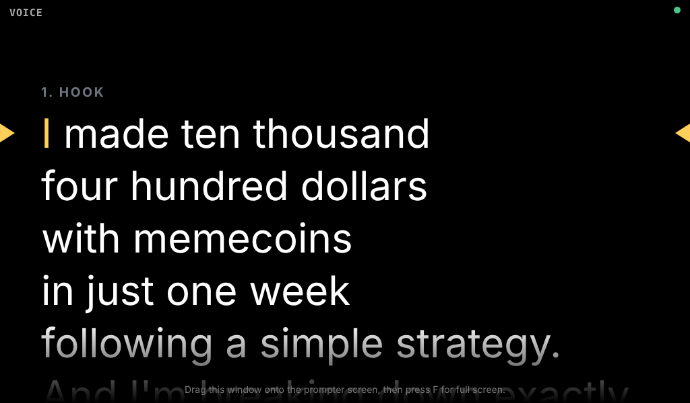

# Prompter Studio

**A free teleprompter that follows your voice, and records two cameras while you read.**

Paste your script, click **Format for prompter**, and read. The text scrolls as you talk, waits when you stop or go off-script for a joke, and jumps back when you re-say a line. Every take saves both cameras, a clean mic track and a list of your retakes, so your editor knows what to cut.

Built for the Elgato Prompter on a Mac, but it works with any second screen and any Chrome.



## What it does

**Voice follow**
- Read, and it scrolls with you, word by word.
- Stop talking, and it waits.
- Ad-lib or tell a joke, and it holds still. Go back to the script and it picks up where you left off.
- Re-say a sentence, and it jumps back there and marks it as a re-say.
- Skip a sentence, and it finds where you are.
- Press **Space** to freeze it completely while you riff.

**Two cameras + mic**
- Camera A, Camera B and the mic record as **separate files**, started together.
- Every camera file carries the same mic audio, so "sync by audio" in Premiere, DaVinci Resolve or Final Cut lines them up in one click.
- Written to disk every ~10 seconds. If something crashes mid-take, **Repair a crashed take** puts the pieces back together.

**Format for prompter**
- Breaks lines at natural phrases, sized to your prompter screen at your text size.
- Spells out numbers the way you say them: `$10,400` → *ten thousand four hundred dollars*, `20%` → *twenty percent*, `2026` → *twenty twenty-six*.
- Strips markdown, links and emoji. Undo restores the original.

**Markers for the edit**
Each take gets its own folder:

```
2026-10-16_1530_my-video/
  camA.mp4          camera A + mic audio
  camB.mp4          camera B + the same mic audio
  mic.m4a           mic only, higher quality
  markers.txt       timecoded RETAKE / KEEP / RE-SAY / SECTION list
  markers.json      same, machine-readable
  transcript.json   what the speech recognizer heard, timecoded
  script.md         the script you read
  session.json      devices, codecs, start offsets
```

## Quick start (Mac)

1. Download this repo (green **Code** button → **Download ZIP**) and unzip it.
2. Double-click **Start Prompter Studio.command**. Chrome opens. Keep the small Terminal window open while you record.
   First time only: if macOS says it can't verify the file, right-click it → **Open** → **Open**.
3. Click **Allow cameras and mic**, then pick Camera A, Camera B and your mic. Plug each camera into its own USB port.
4. Click **Choose recordings folder**.
5. Paste your script, click **Open prompter window**, drag it onto the prompter screen and press **F** for full screen. Then click **✨ Format for prompter**.
6. **Shift+Enter** starts recording (with a 3-2-1 countdown). **Shift+Enter twice** stops and saves.

Not on a Mac? Run `python3 -m http.server 8765` in this folder and open `http://localhost:8765` in Google Chrome.

## Script markup

```
# 1. Hook                  ← section: shown small, never read. Keys 1–9 jump to sections.
I made ten thousand
four hundred dollars
with memecoins in one week.

[SHOW CHART]               ← cue: shown small in blue, never read, ignored by voice follow

And this is the *important* part.   ← *emphasis*: underlined
```

## Keys

Keys work in both windows, so you can map them to a Stream Deck.

| Key | Action |
|---|---|
| Space | Manual: pause/resume. Voice: hold/release |
| R | Retake: back to start of this sentence + marker (twice = sentence before) |
| K | Keep: mark an ad-lib you liked |
| ↑ / ↓ | Previous / next sentence (Shift: paragraph) |
| ← / → | Manual scroll slower / faster |
| 1–9 | Jump to section |
| V | Voice follow ↔ manual |
| [ / ] | Text smaller / bigger |
| M | Mirror text |
| F | Full screen (inside the prompter window) |
| Shift+Enter | Start · press twice to stop |

## How voice follow works

Chrome's speech recognition turns your voice into words. A small matcher (`follow.js`) lines up the last dozen words you said against the script near your current position:

- It only moves forward on a confident run of matching words, so a stray "the" or "money" in a joke doesn't move it.
- Common words count for less than content words, and recognizer slips ("weak" for "week", "ten thousand" for "10,000") still match.
- Jumping back (re-say) or forward (skip) needs a longer, stronger match than normal reading.

It updates in well under a millisecond, even on a 2,000+ word script.

**Privacy note:** by default Chrome sends the audio to Google's speech service for recognition, so voice follow needs internet. Tick **On-device speech** to use Chrome's local recognition where your Chrome version supports it. It falls back to online if not. Your video and audio files never leave your computer.

## Claude skill: teleprompter-script

[`skill/teleprompter-script/SKILL.md`](skill/teleprompter-script/SKILL.md) is a Claude skill that writes (or rewrites) scripts directly in this format: short spoken sentences, phrase-broken lines, numbers written as said, sections, cues and emphasis. The **Format** button does the layout; the skill does what the button can't, like splitting a 30-word sentence or replacing words that are hard to say.

To use it, add the `teleprompter-script` folder to your Claude skills, then ask Claude to "write a teleprompter script about …".

## Tests

```
node tests/follow.test.js     # voice-follow matcher
node tests/follow.stress.js   # 2,000-word script speed + random chatter
node tests/format.test.js     # Format for prompter
python3 tests/e2e.py          # full app in headless Chrome with two fake cameras (needs playwright)
```

## Built with Claude

Prompter Studio was built in an afternoon with [Claude](https://claude.ai) by Handsome Finance.

## License

MIT
